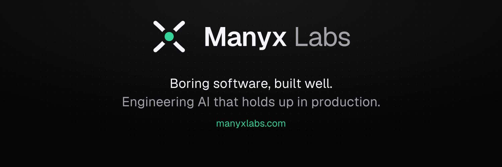

Manyx Labs builds small, boring software for everyday jobs, in Bengaluru.
Every tool does one job, needs no signup, shows no ads, and runs in your browser wherever it can, so your files stay with you.

**In progress**

- **Form Photo & Signature Resizer:** the exact KB, pixel size and format that exam, passport and bank forms ask for.
- **Mutual Fund Screener:** Indian mutual funds compared on rolling returns, risk and real peer performance. A research tool, not investment advice.

We also design and ship production AI systems for teams: multi-agent workflows, retrieval and evals.
Founded by [Manish R](https://github.com/manishonai).

[Website](https://www.manyxlabs.com) · [Suggest a tool](mailto:manish@manyxlabs.com) · [Work with us](https://calendly.com/manishonai)
